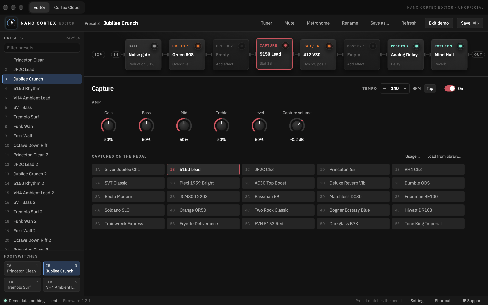

# Nano Cortex Editor for Mac

**Two editions, same editor.** Pick the one for your computer:

| Your computer | Edition | What it is | Get it |
|---|---|---|---|
| **Mac** (macOS 14 or later) | **You are here:** [Nano Cortex Editor for Mac](https://github.com/AJs-Creations/nano-cortex-editor-mac) | Native SwiftUI app: smaller and faster, remembers and reconnects to the pedal, menu bar extra | [Download](https://github.com/AJs-Creations/nano-cortex-editor-mac/releases/latest) |
| **Windows**, or macOS 12–13 | [Nano Cortex Editor](https://github.com/AJs-Creations/nano-cortex-editor) | Cross-platform (Electron) app, the same features and look on macOS and Windows | [Download](https://github.com/AJs-Creations/nano-cortex-editor/releases/latest) |

A native macOS editor for the **Neural DSP Nano Cortex**, over Bluetooth. Edit the whole signal chain from your
desk, manage presets, captures and IRs, send captures from Cortex Cloud straight to the pedal, tune, and practise
with a proper metronome. Unofficial and free (MIT).



> **Unofficial.** Neural DSP and Nano Cortex are trademarks of Neural DSP Technologies Oy; this project is not
> affiliated with or endorsed by Neural DSP.

**[⬇ Download](https://github.com/AJs-Creations/nano-cortex-editor-mac/releases/latest)** ·
**[📖 Manual](docs/MANUAL.md)**

## Features

- **Preset browser**: all 64 presets with a filter; switching with unsaved edits asks first. Right-click a preset to
  load, rename, save the current sound over it, assign it to a footswitch or delete it.
- **Signal chain editing**: gate, two pre effects, capture, cab/IR and three post effects. Turn blocks on and off,
  pick effects, and turn every knob live on the pedal.
- **Captures and IRs**: load from the pedal's library (factory and your own) into any slot, with device-type and
  instrument icons; **Info…** shows a capture's author and tags; a usage scan shows which presets use each slot.
- **Save, Save as, Rename, Delete, Discard**: edits are live; **Save** (⌘S) commits them. Save as copies the
  current sound into another slot; Discard reloads the preset as saved.
- **Footswitch assignment** for the four 4-Preset-mode footswitch slots (IA, IB, IIA, IIB).
- **Expression pedal assignments** per preset: sweeps with heel and toe values, and on/off switches.
- **Preset tempo** with − / +, typing and **Tap**.
- **Tuner** with mute.
- **Metronome**: Simple, or Advanced with time signatures, accents, subdivisions and swing, count-in, a tempo
  trainer, a gap trainer and **Levels**; it can follow the preset's tempo.
- **Settings** (⌘,): accent colours (the Dock icon follows), metronome output and click sounds, connection, and a
  **Device** page for the pedal's LED brightness and USB playback volume.
- **Cortex Cloud** tab: the Cortex Cloud website with your own login; on a capture's page, **Send to Nano Cortex**
  puts it on the pedal.
- **Developer tools** (Settings → Advanced, off by default): session recording of the Bluetooth traffic and the
  **Activity** log. The log file is always written (capped at about 2 MB) for bug reports: **Help → Show Log File**.
- **Keyboard shortcuts** for everything common (press `?` in the app).
- **Menu bar extra**: current preset with previous/next, tuner and metronome without the window.
- **Demo mode**: try every feature without a pedal.
- **Updates**: the app tells you when a new version is out and installs it for you.

## Download

Get **`Nano-Cortex-Editor-mac-<version>-universal.zip`** from the
[Releases page](https://github.com/AJs-Creations/nano-cortex-editor-mac/releases/latest), then:

1. Unzip it (double-click the zip).
2. Move **Nano Cortex Editor.app** to Applications.
3. Open it. macOS asks once to confirm opening an app downloaded from the internet: click **Open**.

It runs natively on Apple Silicon and Intel Macs. The app is signed with a Developer ID and notarised by Apple, so
no security workarounds are needed.

### Requirements

- macOS 14 Sonoma or later.
- A Nano Cortex; tested with firmware 2.2.1.
- Bluetooth: macOS asks for permission on the first Connect; allow it.
- The pedal accepts **one Bluetooth connection**: quit the Cortex Cloud phone app (or turn off the phone's
  Bluetooth) before you connect.

## Also available: cross-platform edition (macOS + Windows)

[**Nano Cortex Editor**](https://github.com/AJs-Creations/nano-cortex-editor) is the Electron edition of the same
editor, for macOS and Windows, with the same features and look. Pick this native one on a Mac (smaller, faster,
remembers and reconnects to the pedal, menu bar extra); pick the cross-platform one on Windows.

## Manual

The [user manual](docs/MANUAL.md) covers installing, connecting, every screen, troubleshooting and the FAQ.
More documentation is listed in [docs/README.md](docs/README.md).

## Build from source

Requirements: Xcode 16 or later (Swift 6), [XcodeGen](https://github.com/yonaskolb/XcodeGen).

```bash
brew install xcodegen
xcodegen generate                    # writes NanoCortexEditor.xcodeproj from project.yml
open NanoCortexEditor.xcodeproj      # build and run the NanoCortexEditor scheme

# or from the command line
xcodebuild -project NanoCortexEditor.xcodeproj -scheme NanoCortexEditor -configuration Debug -derivedDataPath build build
open "build/Build/Products/Debug/Nano Cortex Editor.app" --args -demo   # starts in demo mode

# tests
swift test --package-path NanoCore   # protocol core, headless
xcodebuild -project NanoCortexEditor.xcodeproj -scheme NanoCortexEditor -destination 'platform=macOS' \
  -only-testing:NanoCortexEditorTests test   # app unit tests
```

Layout: `NanoCore/` is the protocol (framing, codec, messages, device state and a simulated pedal; no UI, no
CoreBluetooth); `App/` is the SwiftUI app. See [CONTRIBUTING.md](CONTRIBUTING.md) for the workflow.

## Credits

- The Bluetooth protocol builds on two community editors, both MIT:
  [nano-cortex-editor](https://github.com/DrD85/nano-cortex-editor) by Dominik Schmidt (DrD85) and
  [nano-cortex-web-editor](https://github.com/choldy/nano-cortex-web-editor) by choldy.
- [IBM Plex Sans](https://github.com/IBM/plex), SIL Open Font License 1.1.

Details in [THIRD_PARTY_NOTICES.md](THIRD_PARTY_NOTICES.md).

## Trademarks

Neural DSP and Nano Cortex are trademarks of Neural DSP Technologies Oy; this project is not affiliated with or
endorsed by Neural DSP. Quad Cortex, Neural Capture and Cortex Cloud are Neural DSP trademarks too, named here only
to say what the app works with. The app ships no Neural DSP logos or artwork.

## License

[MIT](LICENSE) © 2026 AJs Creations

If this editor saves you time, you can [buy me a coffee](https://buymeacoffee.com/ajscreations).
