# Nano Cortex Editor for Mac: user manual

Version 1.0. An unofficial, free editor for the Neural DSP Nano Cortex. Every screenshot shows **demo mode** (a
simulated pedal) with the default blue accent; your presets and captures will differ.

> Neural DSP and Nano Cortex are trademarks of Neural DSP Technologies Oy; this project is not affiliated with or
> endorsed by Neural DSP.

## Contents

1. [Install and first launch](#1-install-and-first-launch)
2. [Connecting](#2-connecting)
3. [A tour of the window](#3-a-tour-of-the-window)
4. [Presets](#4-presets)
5. [Editing blocks](#5-editing-blocks)
6. [Footswitches](#6-footswitches)
7. [Expression pedal](#7-expression-pedal)
8. [Tempo](#8-tempo)
9. [Tuner](#9-tuner)
10. [Metronome](#10-metronome)
11. [Cortex Cloud](#11-cortex-cloud)
12. [Settings](#12-settings)
13. [Session recording and the Activity log](#13-session-recording-and-the-activity-log)
14. [Keyboard shortcuts](#14-keyboard-shortcuts)
15. [Menu bar extra](#15-menu-bar-extra)
16. [Troubleshooting](#16-troubleshooting)
17. [FAQ](#17-faq)
18. [Trademarks](#18-trademarks)

---

## 1. Install and first launch

1. Download `Nano-Cortex-Editor-mac-<version>-universal.zip` from the
   [Releases page](https://github.com/AJs-Creations/nano-cortex-editor-mac/releases/latest). The same app runs on
   Apple Silicon and Intel Macs, macOS 14 Sonoma or later.
2. Unzip it and drag **Nano Cortex Editor.app** into **Applications**.
3. Open it. macOS asks once whether you want to open an app downloaded from the internet: click **Open**.

The app is signed with a Developer ID ("Anup Sebastian") and notarised by Apple, so macOS has already checked it and
it opens like any other app. Version 1.0.0 doesn't update itself: download the newer zip once and replace the app
(your settings stay).

### Updates

The app tells you when a new version is out, and you can install it, skip it or be reminded later. You can turn
this off in Settings → [Advanced](#advanced).

## 2. Connecting

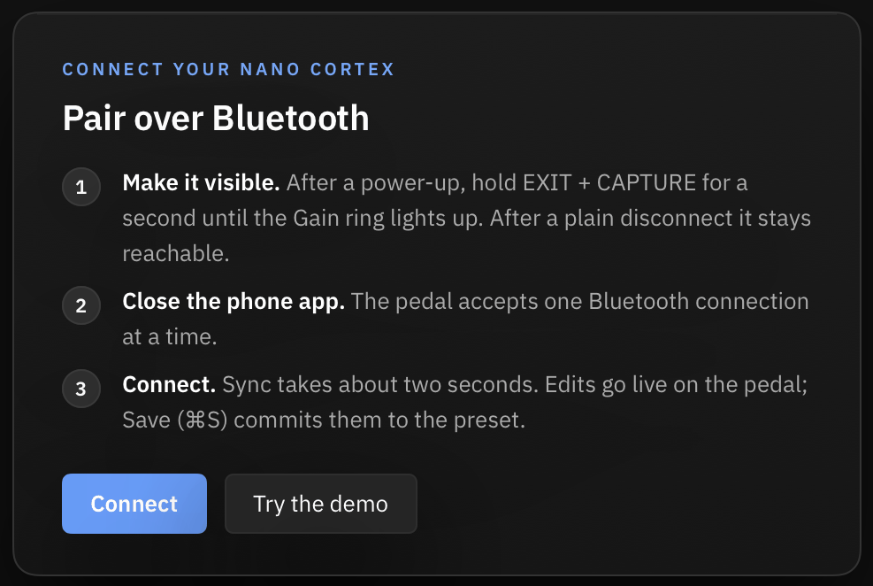

1. **Make the pedal visible.** After powering it up, hold **EXIT + CAPTURE** for about a second until the Gain ring
   lights up. After a plain disconnect from the app it stays reachable, so you only need this after a power-up.
2. **Close the phone app.** The Nano Cortex accepts **one Bluetooth connection at a time**. If the Cortex Cloud
   phone app (or another editor) is connected, the Mac can't find the pedal.
3. **Connect** (the button on the card, in the header, or **⌘K**). The first time, macOS asks whether Nano Cortex
   Editor may use Bluetooth: click **Allow**. If you clicked Don't Allow, turn it on later in **System Settings →
   Privacy & Security → Bluetooth**.

Syncing takes about two seconds: the preset names, the capture and cab slots and the current preset.

If connecting doesn't get anywhere, the card says why while it keeps trying: Bluetooth is off, the app isn't allowed
to use Bluetooth, or no pedal has turned up after about 20 seconds. **Troubleshooting** under the message opens
[Troubleshooting](#16-troubleshooting) in your browser. **Read the manual** on the card opens this manual.

**The remembered pedal.** Once the first connection has found the pedal's editor service, the app remembers your
pedal. It reconnects at launch (you can turn this off in [Settings → Connection](#connection)), and if the pedal
powers off it waits and reattaches by itself when the pedal comes back; you only press EXIT + CAPTURE on the pedal.
The status bar shows *Waiting for …* meanwhile; **Stop waiting** in the header cancels it.

**Demo mode.** **Try the demo** (or **Pedal → Demo mode**) connects to a simulated pedal with 24 presets, captures and
cabs. Everything works, and nothing is sent anywhere; the status bar says *Demo data, nothing is sent*. **Exit demo**
in the header ends it.

> Edits are **live** on the pedal: what you change, you hear. **Save** (⌘S) commits them to the preset. The app
> never saves on its own.

## 3. A tour of the window

### Tab bar

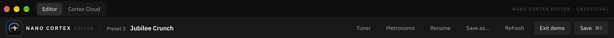

The top row switches between **Editor** (⌘1) and **Cortex Cloud** (⌘2). Drag the window by its empty parts.

### Header

Left to right: the app mark, **Preset N** and its name (double-click the name to rename), *Unsaved changes* while the
pedal reports unsaved edits, then **Tuner**, **Mute** (the pedal's guitar input, see [Monitoring](#monitoring); red while
muted), **Metronome**, **Rename**, **Save as…**, **Refresh** (re-reads everything from the pedal, ⇧⌘R), **Connect /
Disconnect / Exit demo**, **Discard** (only while there are edits) and **Save**. Save turns the accent colour when there
is something to save. The unsaved-changes mark, Save and Discard follow the pedal's own report: put an edit back the way
it was saved and the mark goes away. In a narrow window the text buttons hide; they are in the menus too (Mute is in
Settings → Device).

### Preset sidebar and Footswitches strip

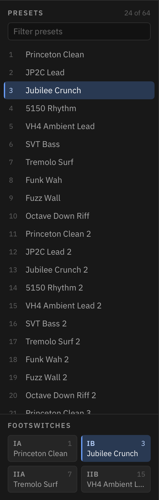

The 64 presets with their numbers; empty slots read *Empty*. Type in **Filter presets** to narrow the list by name or
number. Under the list, the **Footswitches** strip shows which preset each footswitch slot holds (see
[Footswitches](#6-footswitches)).

### Signal chain

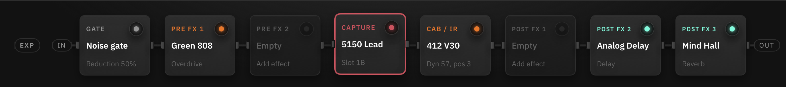

The eight blocks in signal order: **Gate**, **Pre FX 1–2**, **Capture**, **Cab / IR**, **Post FX 1–3**. Each card
shows the block's name, what's loaded and a short detail; the dot in its corner turns it on or off. Click a card to
edit it below. The **EXP** pill before IN opens the [expression pedal](#7-expression-pedal) panel and shows how many
assignments the preset has.

### Inspector

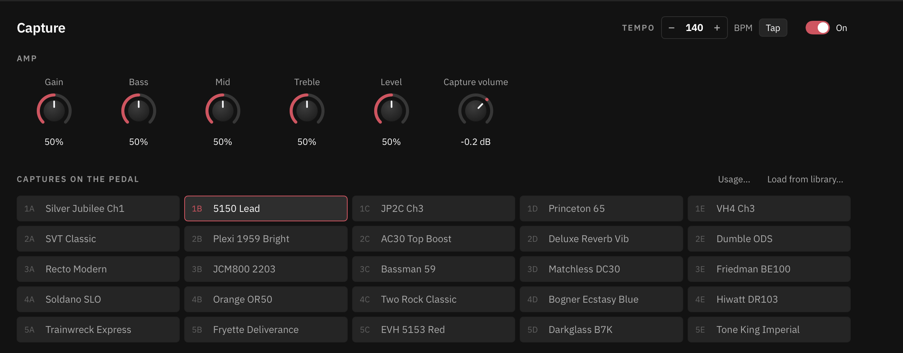

Everything about the selected block: its on/off switch, its controls, and for Capture and Cab / IR the slots on the
pedal. The **Tempo** control at the top right belongs to the preset (see [Tempo](#8-tempo)).

### Status bar

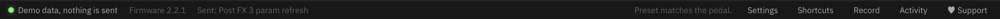

The link LED and state (green when connected), the pedal's firmware, and whether the preset matches what's saved on
the pedal (as the pedal reports it). After a preset move whose read-back failed it says *Current preset unknown: Refresh
to read it* instead (see [Presets](#4-presets)). On the right: **Settings**, **Shortcuts** and **♥ Support**, which opens the project's Buy Me a Coffee page
in your browser. With [Developer tools](#advanced) on, the bar also shows the last message sent ("Sent: …"),
**Record** (session recording) and **Activity** (the protocol log, ⌘L).

### Help menu

**Help** has **Nano Cortex Editor Manual** (this manual, on GitHub), **GitHub Repository**, **Report an Issue**,
**Show Log File** and **Support the Project…**. The links open in your browser; **Show Log File** shows the app's
log file (`activity.log`) in Finder, to attach to a bug report. **Nano Cortex Editor → About Nano Cortex Editor** shows the
version and the same links.

## 4. Presets

**Switch** by clicking a preset in the list, with **⌘↑ / ⌘↓**, from the menu bar extra, or by clicking a footswitch
slot. If the current preset has unsaved edits, the app asks first, because the pedal drops edits when it loads another
preset:

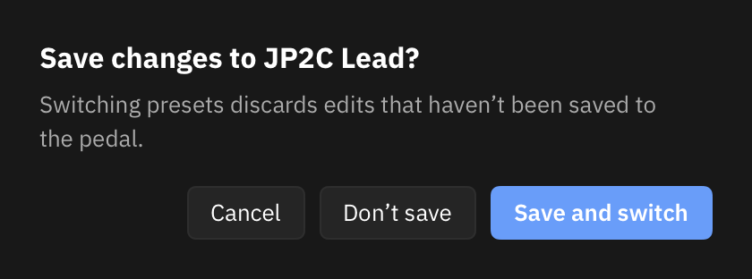

**Save** (⌘S) writes the live sound into the current preset.

**Save as…** (⇧⌘S) writes the current sound, including unsaved edits, into another slot under a new name, then
switches to it. The preset you started from keeps what it had. Pick a slot (empty ones are at the end) and press
**Save to preset N**:

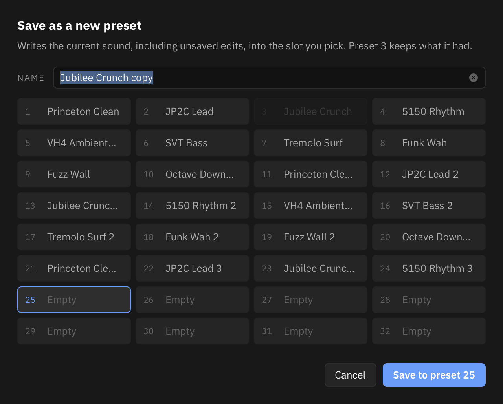

**Rename** (header button, double-click the name, or the row's menu): at least 4 characters. The pedal renames the
stored preset immediately; no Save needed.

**Delete** (**Pedal → Delete Preset…** or the row's menu): the slot becomes empty. There is no undo; if you might want
it back, use Save as… to copy it to a free slot first.

**Discard** (header button or **Pedal → Discard Edits…**) throws your unsaved edits away and reloads the preset as it
was last saved:

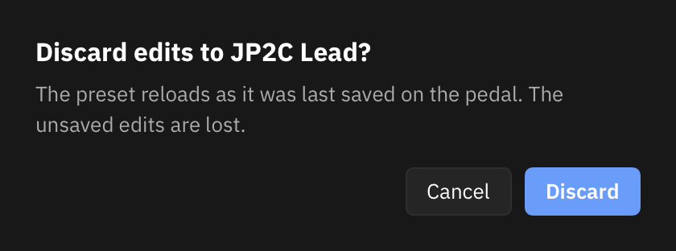

**Right-click a preset** for: **Load**, **Rename…**, **Save current sound here…** (or *over this preset…*, which
opens Save as with that slot picked), **Assign to footswitch IA / IB / IIA / IIB**, and **Delete…**.

**Reordering.** Drag a preset onto another row to move it there; the presets in between shift by one place (an
insert, not a swap). It works with the filter on, too. With unsaved edits the editor asks first, as for a switch. After
the move it reads the preset list and the current preset back from the pedal, so what you see is the pedal's order. If
that read fails, the header shows **Preset ?** and Save, Save as, Rename and Discard stay off until a read succeeds
(**Refresh**, or pick a preset). Check your footswitch assignments after moving presets. Reordering is off while a
slot usage scan (**Usage…** in the Capture inspector) runs.

**Changes on the pedal itself** show up as you make them: turning a knob, switching an effect with a footswitch (or the
expression pedal's switch, or a MIDI CC over USB), or moving the expression pedal updates the knobs and lights in the
editor. Effect amounts the expression pedal controls are read back from the pedal while it moves.

## 5. Editing blocks

### Knobs

Every parameter is a knob. **Drag** up or down to turn it; hold **Shift** for fine control. With a knob focused, the
**arrow keys** step it. **Double-click** resets it to its default. **Click the value** under it to type an exact
number. Changes go to the pedal while you drag.

### Gate

The adaptive noise gate sits at the input, before everything else. Turn it on and set **Reduction** (0–100 %).

### Pre FX and Post FX

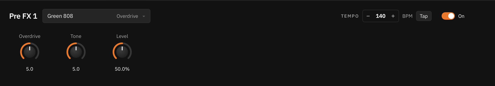

Click the effect field to pick a model from a searchable list (**None** empties the slot). Pre slots take drives,
compressors, wahs, EQ and pitch; Post FX 1 takes modulation and EQ/utility, Post FX 2 delays and EQ/utility,
Post FX 3 reverbs and EQ/utility. Right-click a chain card for **Bypass / Enable**, **Change effect…** and
**Clear slot**.

### Capture

The **Amp** section has Gain, Bass, Mid, Treble, Level and **Capture volume** (dB). Below, **Captures on the pedal**
lists the 25 capture slots, named **1A–5E** (bank and position). Click a slot to use it in this preset. A small
number on a slot tells how many presets use it, after a scan: **Usage…** switches through every preset to find out
(save or discard your edits first) and lists which presets each slot feeds and which slots are free.

**Load from library…** opens the pedal's library, factory captures and your own:

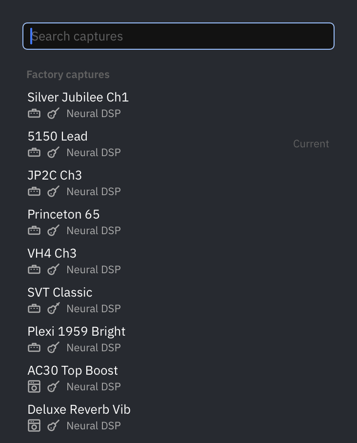

Each capture shows small icons for its device type (amp head, combo, pedal) and instrument (guitar, bass), then its
author. Pick one, then choose the slot it should go into. **Whatever is in that slot is replaced**, and every preset
that uses the slot plays the new capture.

**Info…** (right-click the Capture card or a capture slot) shows the capture's details (with
[Developer tools](#advanced) on, also its hash, with Copy):

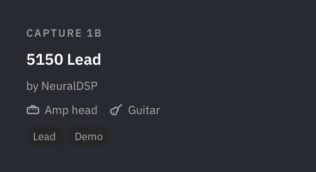

### Cab / IR

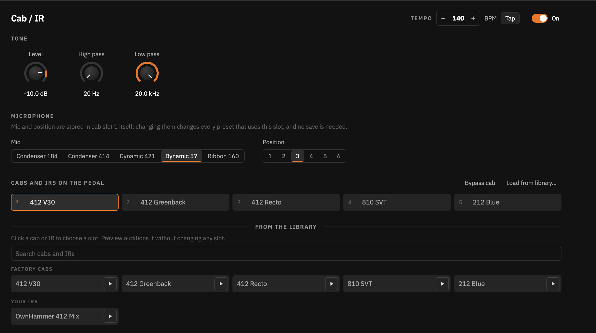

**Tone**: Level, High pass and Low pass. **Microphone**: five mics and positions 1–6. Note that mic and position
are stored **in the cab slot itself**: changing them changes every preset that uses the slot, and no save is needed.
**Cabs and IRs on the pedal** lists the five cab slots; **Bypass cab** turns the cab off; **Load from library…** works
as for captures.

**From the library** lists the pedal's factory cabs and your IRs, with a search box. Click an item to choose a slot
for it. Its **▶** button auditions it: the pedal plays that IR without loading it into a slot (the row lights up and
the button turns into **■**, which stops it). While an IR is auditioned the microphone and position are locked.
Right-click an item for **Preview** and **Load into slot…**; your own IRs also have **Delete…**, which removes the IR
from the pedal after you confirm (there is no undo; the dialog says if one of the five slots holds that IR).
Saving or changing the preset stops an audition first; if the pedal doesn't confirm the stop, the action doesn't
happen and the app says so.

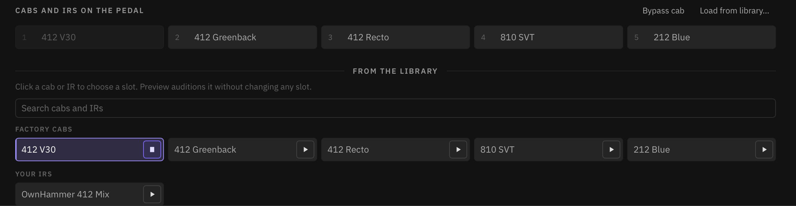

### Right-click menus

- **A preset row**: load, rename, save the current sound here, assign to a footswitch, delete.
- **A chain card**: bypass/enable, change or add an effect, clear the slot; on Capture and Cab, pick from the
  library and Info….
- **A capture or cab slot**: load into this preset, put a library item in this slot, Info….
- **A cab or IR under From the library**: Preview (or Stop preview), Load into slot…, and on your own IRs Delete….

## 6. Footswitches

In the pedal's 4-Preset mode, footswitches I and II with banks A and B call up four presets: **IA, IB, IIA, IIB**.
The **Footswitches** strip under the preset list shows each slot's preset number and name; the current one is
highlighted.

- **Click** a slot to load its preset.
- **Right-click → Assign current preset** puts the current preset on that switch.
- **Right-click → Assign…** opens a searchable list of all presets:

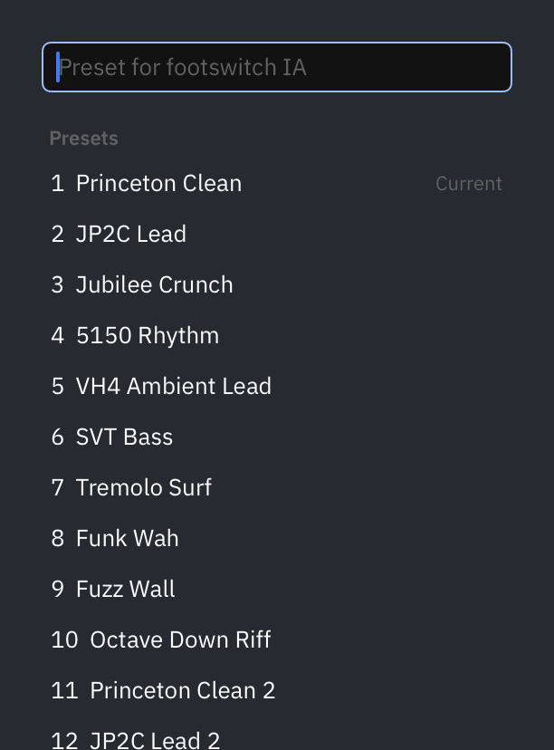

You can also right-click a preset row → **Assign to footswitch …**. Assigning makes the pedal reload the current
preset, which drops unsaved edits, so with edits the app asks *Save changes to …?* first. Presses on the pedal's
own footswitches show up in the app as they happen.

## 7. Expression pedal

Click the **EXP** pill at the start of the chain. The panel lists the current preset's assignments:

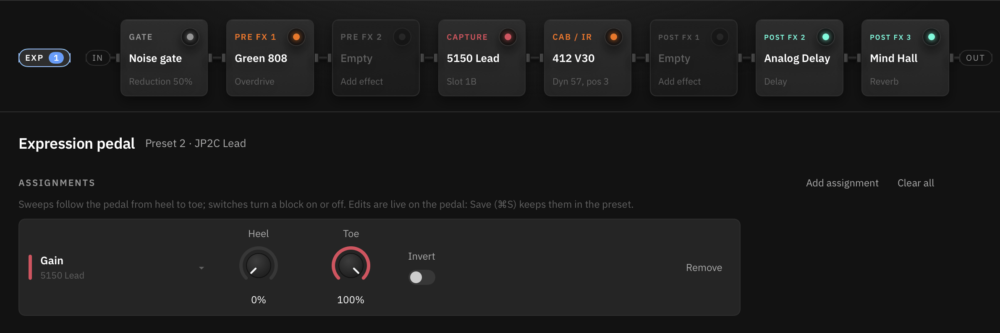

- **Add assignment** and pick a target. **Sweeps** (gain, bass, mid, treble, level, the gate and the effects'
  amounts) follow the pedal from **heel** to **toe**; set both ends with the knobs, in the parameter's own units
  (dB for capture volume, % for the rest), and **Invert** to reverse it.
- **Switches** turn a block on or off: heel-toe with a delay, toggle with **latch** (each press toggles instead of
  holding), and invert.
- **Remove** deletes one assignment; **Clear all** deletes them all.

Edits are live on the pedal; **Save** (⌘S) keeps them in the preset. Plug the expression pedal into the Nano
Cortex's EXP/MIDI jack.

## 8. Tempo

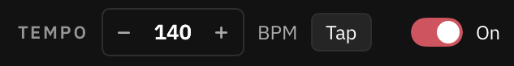

Each preset has a tempo (for its delays and modulation). Change it with **− / +**, by **dragging** the TEMPO label
sideways, by clicking the number and **typing**, or with **Tap** (tap the beat; the preset gets the tempo when you
stop). The pedal follows while you change it; when you stop, the app writes it into the preset, which then counts as
edited: **Save** keeps it. The metronome can follow the preset tempo (see below).

## 9. Tuner

**Tuner** in the header or **⌘T**. Play a note: the note name shows above the meter, and it turns green when you're
within 3 cents. **Mute output** silences the pedal while you tune. **Done**, Esc, or a click outside closes it. If the
guitar input was muted (header **Mute**) when you opened the tuner, it is muted again when the tuner closes.

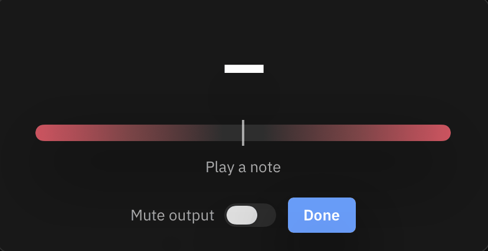

## 10. Metronome

**Metronome** in the header or **⌘M** opens the overlay; **Space** starts and stops it. While it runs, the header
button shows ♩ and the tempo.

### Simple

Tempo (− / +, the slider, or type), beats per bar, **Tap tempo**, volume and output.

### Advanced

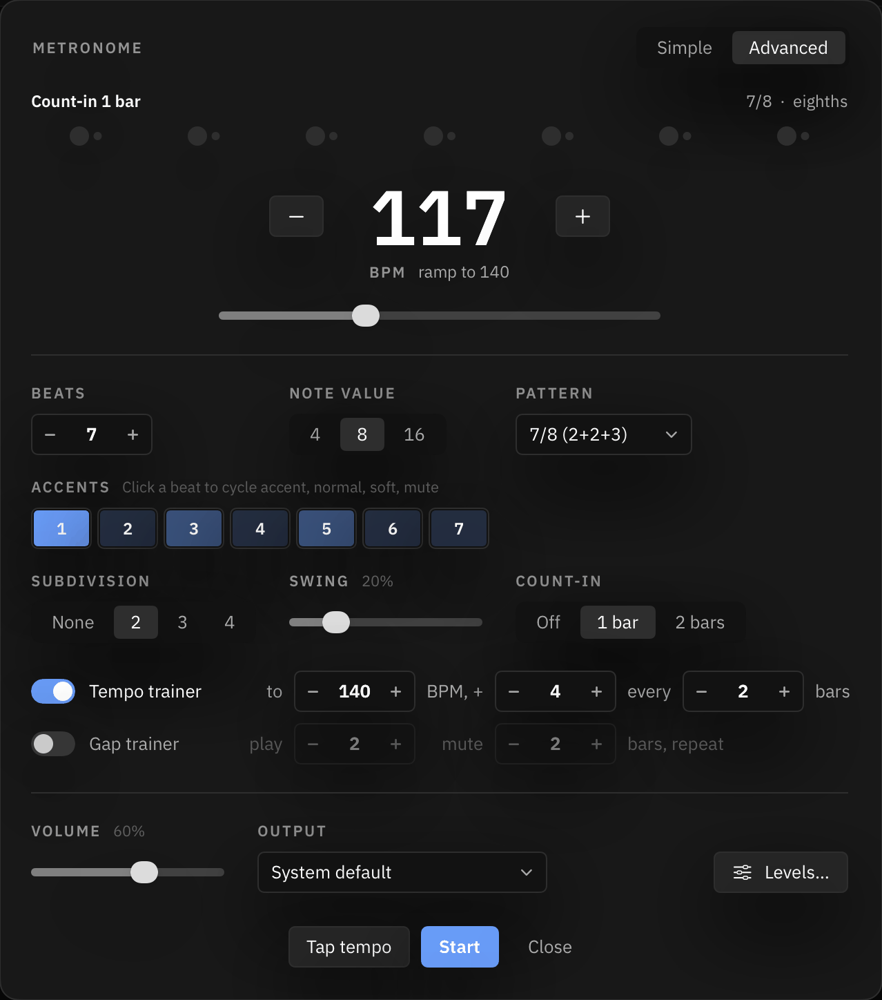

- **Beats** 1–16 over a **note value** of 4, 8 or 16; **Pattern** picks common meters (e.g. 5/4 as 3+2,
  7/8 as 2+2+3). The tempo counts the note value: 7/8 at 120 is 120 eighths per minute.
- **Accents**: click a beat to cycle **accent → normal → soft → mute**. Muted beats still play their subdivisions,
  for off-beat practice.
- **Subdivision** None, 2, 3 or 4, with **Swing** (100 % = triplet feel).
- **Count-in** off, 1 or 2 bars.
- **Tempo trainer**: from the current tempo, **+N BPM every M bars** up to a target. Stop returns to the start tempo.
- **Gap trainer**: **play N bars, mute M bars**, repeat; the indicator keeps going through the silent bars.
- The numbers in the steppers are **typeable**: click, type, Enter (Esc cancels).
- **Levels…** sets the loudness of accents, main ticks and subdivisions:

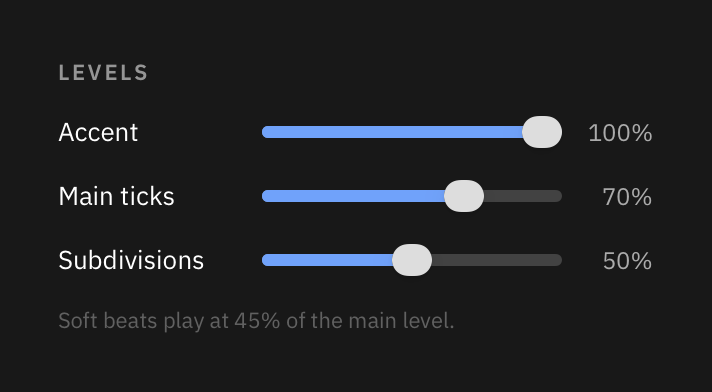

**Follow the preset tempo** (in [Settings → Metronome](#metronome)): while a pedal is connected the metronome shows
and follows the preset's tempo, and changing the metronome's tempo writes it to the preset (Save keeps it). The
overlay then shows *♩ follows preset*.

## 11. Cortex Cloud

The **Cortex Cloud** tab (⌘2) shows the Cortex Cloud website inside the app. Sign in on the site's own page with your
Neural DSP account; the app keeps the session. Your Mac's password autofill works there. Links outside Cortex Cloud
open in your browser.

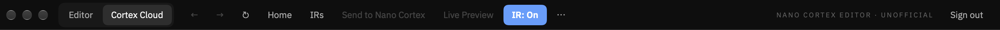

The toolbar has **back**, **forward**, **reload**, **Home**, **IRs**, **Send to Nano Cortex**, **Live Preview**,
**IR: On / Off**, a **⋯** menu and **Sign out**.

To put a capture on the pedal:

1. Connect the pedal (in the Editor tab).
2. In Cortex Cloud, open a capture's page. **Send to Nano Cortex** lights up.
3. Click it, check the name and size, and click **Send**. The capture streams over Bluetooth (a few seconds) into the
   pedal's library; none of your presets change.
4. The app offers to load it into a slot now (**Choose a slot**) or **Later** (Capture → Load from library…).

Nano presets on Cortex Cloud are Quad Cortex presets and can't be sent.

**Live Preview.** On a capture's page, **Live Preview** plays the capture on the pedal without storing it anywhere:
no slot or library item changes. **Stop Preview** ends it. **IR: On / Off** next to it switches the cab / IR of the
current preset, to hear the capture with or without it. A preview keeps running while you browse; anything that saves
or changes the preset (Save, switching presets, Discard, Rename, …) stops it first, and if the pedal doesn't confirm
the stop, that action doesn't happen. The pedal must be connected (the button is grey otherwise); while a preview
plays, Send to Nano Cortex waits.

**Sending an IR to the pedal.** Open your profile's **Impulse Responses** list (**IRs** in the toolbar). The app adds
**Send to Nano** beside each IR. Click it, confirm in the Editor, and the app sends the WAV to the pedal's IR library
over Bluetooth. It does not change a preset slot. After the pedal accepts the IR, the editor reads the library again,
so it appears under **From the library** (Cab / IR inspector), and the button reads **On Nano**. An IR that is already
on the pedal (same name) isn't sent again. Only WAV files up to 1 MB in PCM or float format, mono or stereo, are
sent. If something goes wrong the button reads **Retry** (its tooltip says why); nothing is retried by itself.

Only one transfer to the pedal runs at a time (a capture, an IR or a preview): while one is going, another one
doesn't start and the app says so; try again when the first has finished.

## 12. Settings

**⌘,** or **Settings** in the status bar.

### Appearance

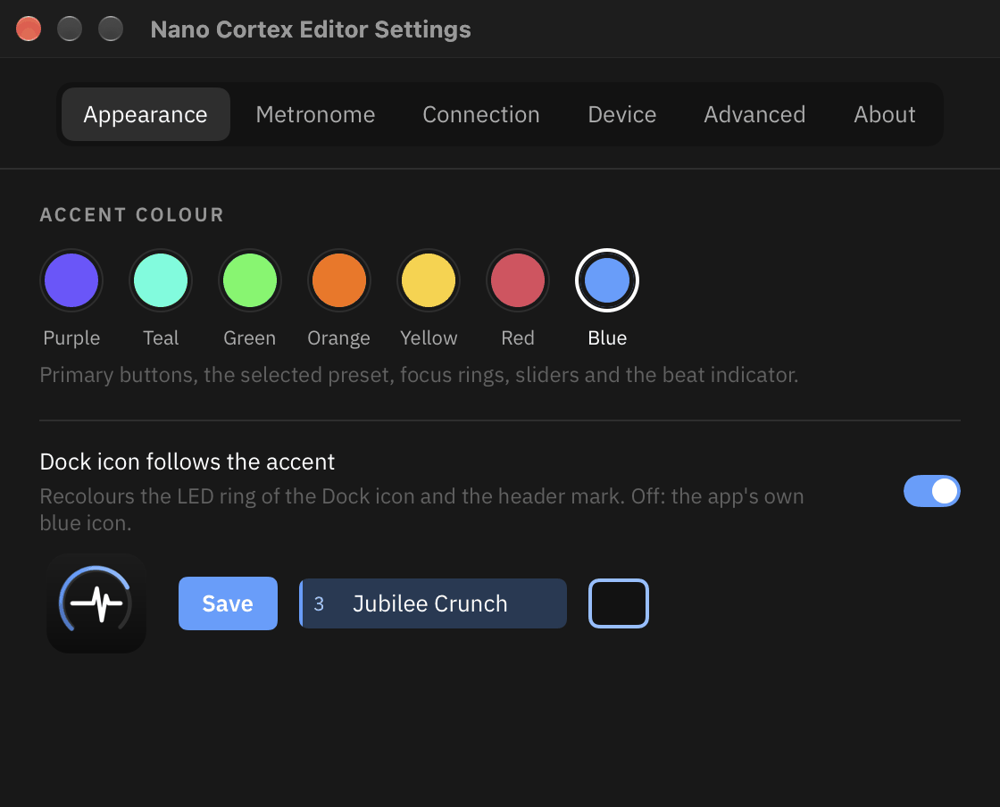

**Accent colour**: purple, teal, green, orange, yellow, red or blue (the default). It colours primary buttons, the
selected preset, focus rings, sliders and the beat indicator, live. **Dock icon follows the accent** recolours the LED
ring of the Dock icon and the header mark; off, the app uses its own blue icon. After you quit, the Dock shows the
app's built-in blue icon.

### Metronome

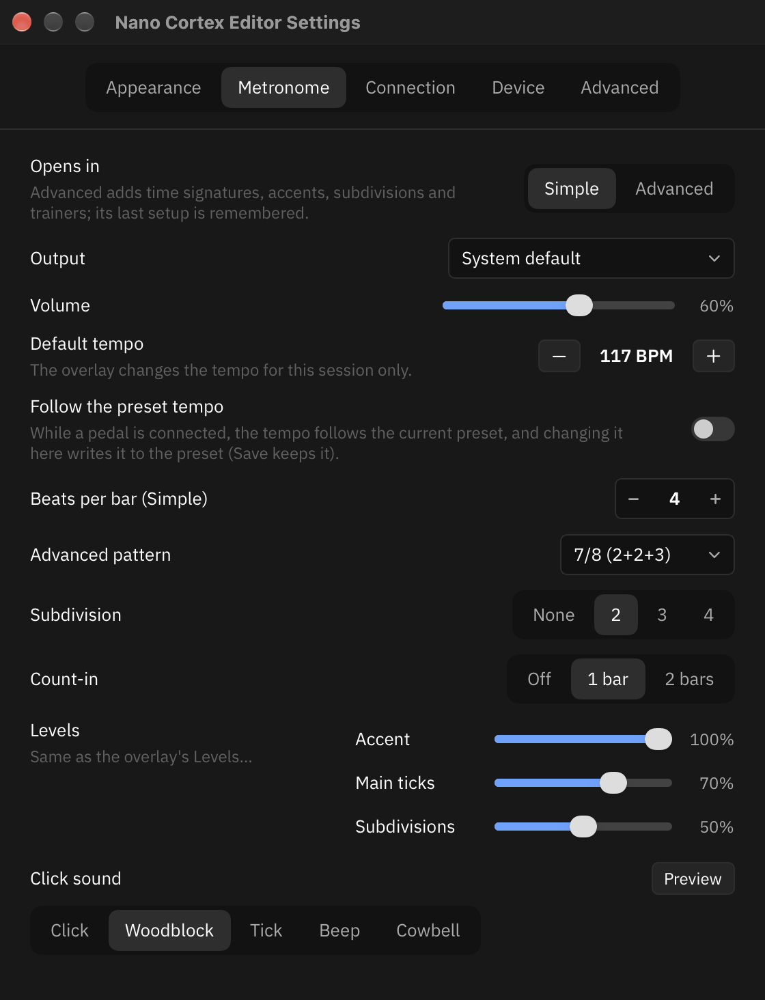

**Opens in** Simple or Advanced, **Output** (any audio device; System default follows macOS), **Volume**, **Default
tempo** (the overlay changes the tempo for the session only), **Follow the preset tempo**, beats for Simple, the
Advanced pattern, subdivision, count-in, **Levels**, and the **Sounds** of the **Accent**, **Main beat** and
**Subdivision**: Click, Woodblock, Tick, Beep or Cowbell (▶ plays one, **Preview** a bar). **Custom sample…** uses
your own WAV, AIFF, CAF, MP3, M4A or FLAC file instead (up to 5 MB; the first 2 seconds play); the app keeps a copy,
and **Reset** goes back to the built-in sound.

### Connection

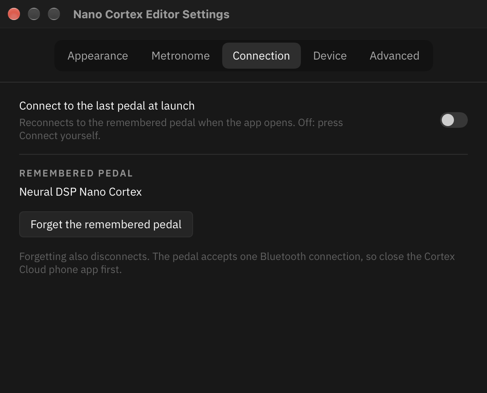

**Connect to the last pedal at launch** (on by default) and the **remembered pedal**. **Forget the remembered pedal**
disconnects and makes the next Connect scan for a pedal again.

### Device

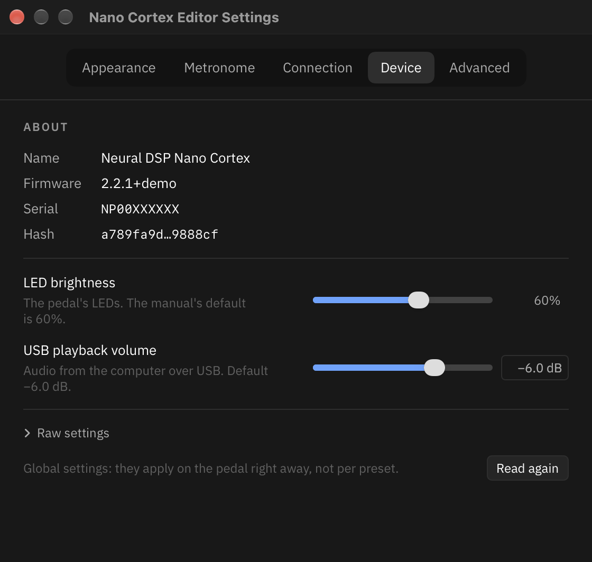

Global settings of the pedal, read when you open the page: **About** (name, firmware build, serial), **LED
brightness** (in %) and **USB playback volume** (−20 to 0 dB, typeable) for audio from the computer over USB. They
apply on the pedal right away, not per preset. **Read again** re-reads them. With [Developer tools](#advanced) on,
About also shows the pedal's hash, and **Raw settings** shows the other values the pedal reports, read-only.

**Monitoring**: **Mute Input** mutes the guitar input (USB audio still plays) and **Mute
Outputs 1L/2R** mutes the processed sound at the outputs. Also global, and nothing to save. The header's **Mute**
button is the same switch as **Mute Input**; it is read from the pedal when you connect. If the pedal doesn't take a
change, the switch goes back and the page says so.

### Advanced

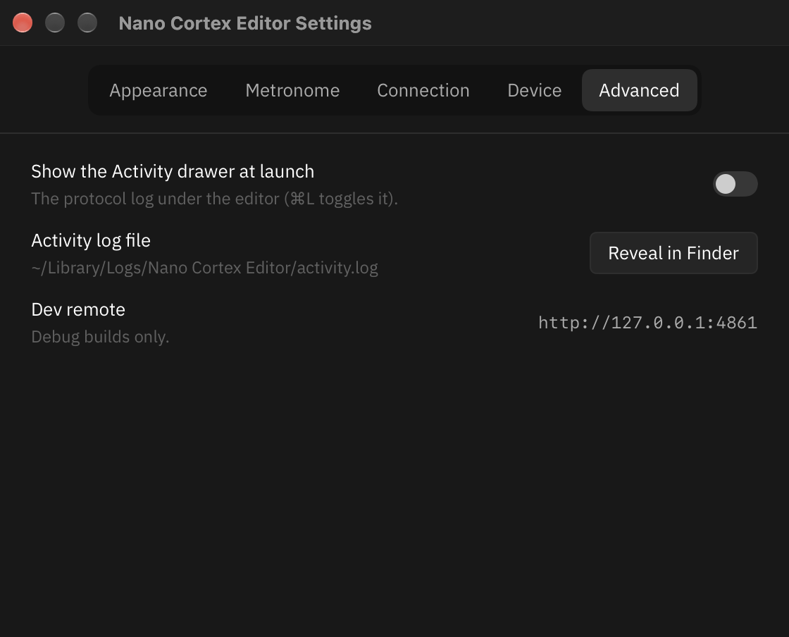

**Check for updates automatically** (on by default): see [Updates](#updates).

**Developer tools** (off by default) shows the Activity log, session recording and protocol details, for
troubleshooting and development: **Record** and **Activity** in the status bar, **⌘L** and **View → Activity Log**,
the "Sent: …" text in the status bar, the pedal's hash and **Raw settings** on the Device page, and the hash in a
capture's **Info…**. It takes effect right away; turning it off closes the Activity drawer and ends a recording in
progress (the recording is saved to the default folder). With it on, this page also has **Show the Activity drawer
at launch** and the **Activity log file** with **Reveal in Finder**. (The *Dev remote* row only appears in debug
builds made from source.)

The log file (`~/Library/Logs/Nano Cortex Editor/activity.log`) is written whether Developer tools are on or not, so
a bug report can include it (**Help → Show Log File**). It is capped: past about 2 MB it moves to `activity.1.log`
and a new one starts, so at most two files are kept.

### About

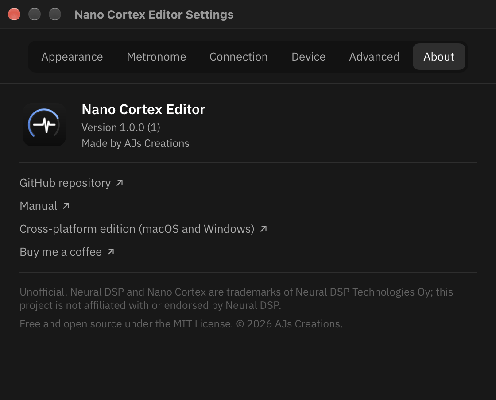

The app's version and who made it, with links to the **GitHub repository**, this **Manual**, the **cross-platform
edition** (macOS and Windows) and **Buy me a coffee**. They open in your browser.

## 13. Session recording and the Activity log

Both need **Developer tools** (Settings → [Advanced](#advanced)).

**Activity** in the status bar (or **⌘L**, or **View → Activity Log**) opens the protocol log under the editor: every
message sent (TX) and received (RX), with times. The same lines go to the log file above, so you can `tail -f` it.

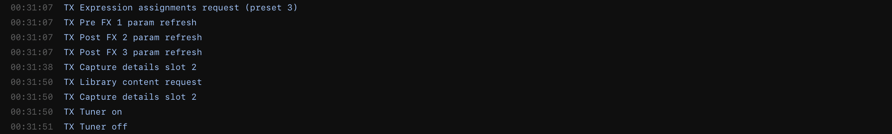

*The Activity drawer, with Developer tools on.*

**Record** in the status bar captures every Bluetooth packet in both directions, with timestamps and the log lines.
The button reads *Recording N* in red while it runs; click it again to save the JSON file (by default in
`~/Documents/Nano Cortex Editor`). Recordings help when reporting a bug or decoding a feature. **They contain your
pedal's data** (preset and capture names, the serial), so check what you share.

## 14. Keyboard shortcuts

Press **?** (when no text field has focus) or **View → Keyboard Shortcuts** for this list in the app:

| Keys | Action |
|---|---|
| ⌘S | Save to the current preset |
| ⇧⌘S | Save as a new preset, in another slot |
| ⌘, | Settings: accent colour, metronome sounds, connection |
| ⌘↑ / ⌘↓ | Previous / next preset |
| Pedal menu | Rename, Discard Edits…, Delete Preset…, Demo mode |
| Right-click | A preset: load, rename, save here, delete. A node: bypass, change effect, clear. A slot: load, put a library item here |
| ⇧⌘R | Re-read everything from the pedal |
| ⌘K | Connect or disconnect |
| ⌘1 / ⌘2 | Editor / Cortex Cloud |
| ⌘L | Show Bluetooth activity (Developer tools) |
| Record | In the status bar: record every packet, then save it as JSON (Developer tools) |
| ⌘T | Tuner (Esc closes it) |
| ⌘M | Metronome (Space starts and stops it) |
| ? | This list (Esc closes any sheet or overlay) |
| Drag, arrows | Adjust a knob. Hold Shift for fine control |
| Double-click a knob | Reset it |
| Click a value | Type an exact value |

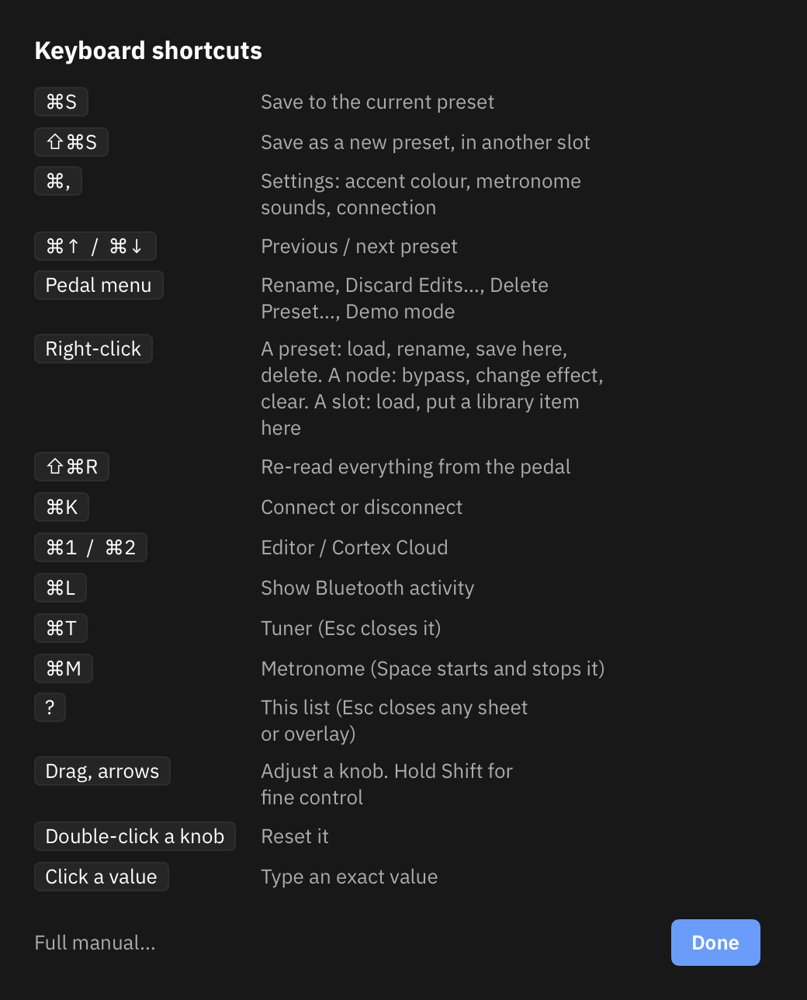

**Full manual…** at the bottom of the sheet opens this manual in your browser.

## 15. Menu bar extra

A waveform icon in the menu bar (filled while connected) gives you the pedal without the window: the link state, the
current preset (• when edited) with **Previous preset** and **Next preset**, **Tuner**, **Start / Stop metronome**
at the current tempo, **Show Nano Cortex Editor** and **Quit**. With no pedal connected it offers **Connect**.

## 16. Troubleshooting

**"Nano Cortex Editor can't be opened" / "Apple could not verify…" / "is damaged".** Current releases are signed
and notarised, so this means an older unsigned copy or an incomplete download. Delete the app, download the zip
again from the [Releases page](https://github.com/AJs-Creations/nano-cortex-editor-mac/releases/latest), unzip it in
Finder and move it to Applications. (Right-click → Open no longer gets past this on macOS 15 and later, so don't
rely on it.)

**Connect keeps scanning and never finds the pedal.**
- Hold **EXIT + CAPTURE** on the pedal until the Gain ring lights (needed after every power-up).
- Quit the Cortex Cloud phone app, or turn off the phone's Bluetooth: the pedal takes one connection.
- Check **System Settings → Privacy & Security → Bluetooth**: Nano Cortex Editor must be allowed.
- Turn the Mac's Bluetooth off and on, then Connect again.

**It connected before, now it says "Waiting for …".** The app is waiting for the remembered pedal. Power the pedal
up and press EXIT + CAPTURE; it reattaches by itself. **Stop waiting** cancels.

**"… isn't a Nano Cortex" or "didn't finish setting up".** The app remembers a device only after it has found the
Nano Cortex's editor service on it. A device without that service is forgotten (if it was remembered) and skipped
until you quit the app: hold EXIT + CAPTURE on the pedal and click **Connect** to look for it. If the pedal connects
but doesn't finish setting up within 10 seconds, the app stops and keeps it remembered: move closer, close the phone
app and connect again.

**My edits disappeared.** Edits are live but not stored until you **Save**. Switching presets, assigning a footswitch
or Discard reloads the stored preset. With edits pending, the app asks before switching.

**A cab mic change affected other presets.** That's how the pedal works: mic and position belong to the cab slot.

**Send to Nano Cortex stays grey.** Open a capture's own page in Cortex Cloud (not a list or a preset), and connect
the pedal first. While a Live Preview plays, stop it first.

**No Send to Nano buttons on my IRs.** They appear on your profile's Impulse Responses list (**IRs** in the toolbar)
once you're signed in. If Cortex Cloud changes that page, the buttons may not appear until the app is updated; the
site itself keeps working.

**"The pedal did not confirm stopping the preview, so … did not happen."** An audition (Live Preview, or ▶ in From the
library) is still playing as far as the app knows. Click **Stop Preview** or **■** and try again; if the pedal keeps
not answering, disconnect and connect again.

**The metronome is silent or on the wrong device.** Check the volume in the overlay and **Output** (Settings →
Metronome).

**Something else looks wrong.** Choose **Help → Show Log File** and attach `activity.log` to your bug report (it
lists what the app sent and received; check it for anything you don't want to share). To watch the log live, turn on
**Developer tools** (Settings → Advanced) and open **Activity** (⌘L); a **Record**ing of the problem helps too.

## 17. FAQ

**Is this an official Neural DSP app?** No. It's an independent, unofficial project, not affiliated with or endorsed
by Neural DSP.

**Can it damage my pedal or lose my presets?** It sends the same messages as the official app, and nothing is stored
until you Save, rename or delete. Delete and Save as overwrite slots, as on the pedal. As with any editor, back up
presets you care about in the official app before experimenting.

**Does it work over USB?** No. Over USB the pedal only accepts MIDI program and control changes and sends nothing
back, so editing needs Bluetooth.

**Can I use it and the phone app at the same time?** No, the pedal accepts one Bluetooth connection.

**Which firmware?** Tested with 2.2.1.

**Footswitch, expression and Device settings: are they safe?** They were decoded from the official app's traffic and
are byte-identical to it in our tests, but they're new in 1.0 and still awaiting confirmation on more pedals. Report
anything odd.

**Mac or Windows edition?** On a Mac, this one. The
[cross-platform edition](https://github.com/AJs-Creations/nano-cortex-editor) has the same features for Windows
(and macOS).

**Where are my settings?** In the app's preferences (`com.community.nanocortex`); the Cortex Cloud login lives in the
app's web data. Deleting the app keeps both.

**Can I support the project?** It's free. If it saves you time, you can
[buy me a coffee](https://buymeacoffee.com/ajscreations).

## 18. Trademarks

Neural DSP and Nano Cortex are trademarks of Neural DSP Technologies Oy; this project is not affiliated with or
endorsed by Neural DSP. Quad Cortex, Neural Capture and Cortex Cloud are also trademarks of Neural DSP Technologies
Oy and are named only to describe compatibility. The app contains no Neural DSP logos or artwork.
